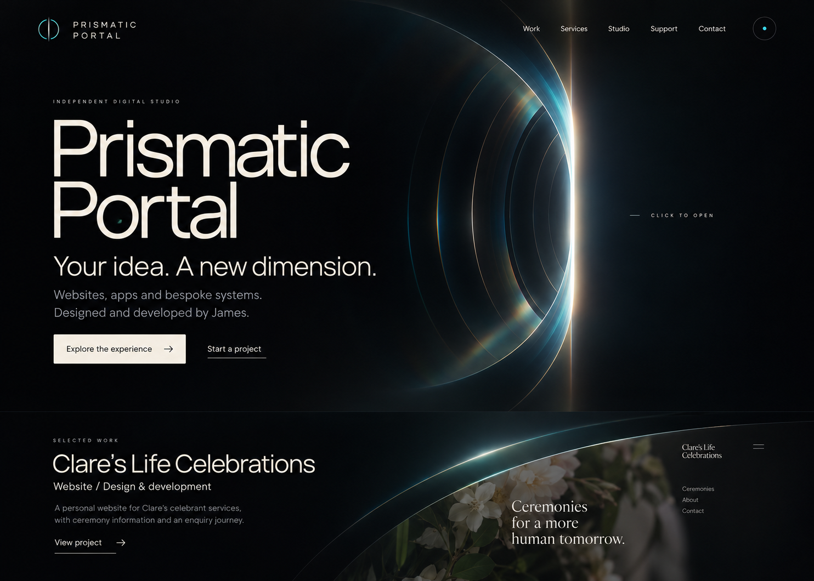
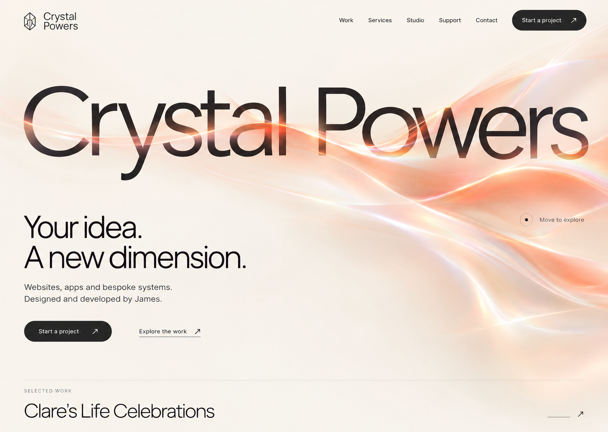
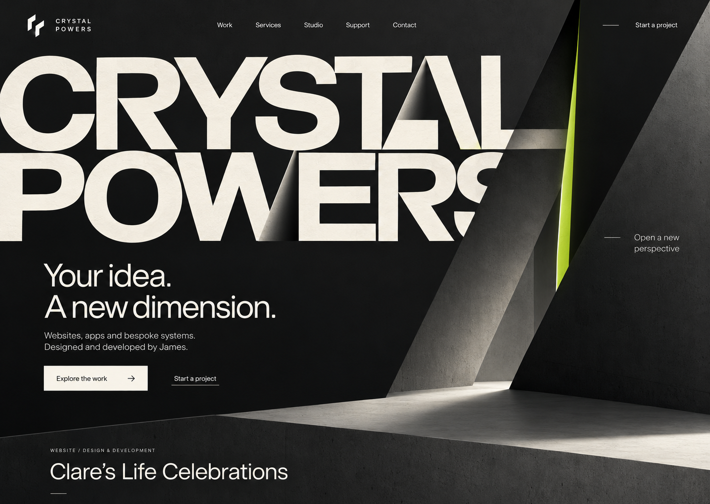

# Crystal Powers 2.0 — design choices and motion brief

Updated 12 October 2026. James selected **2 — Liquid Light** and authorised dependency updates/migration. The three images below retain the alternatives in their original displayed order. The selected direction now has an editable development preview and a source implementation on Home; it has not passed final QA or been released. See [Liquid Light implementation](LIQUID_LIGHT_IMPLEMENTATION.md).

The current Aurora opening remains in source as a reversible implementation baseline. Its technical evidence does not constitute acceptance of the new appearance. Existing routes, roles, APIs, validation, upload/email handling, owner publishing, security, theme/preferences and legacy redirects remain requirements. Only Clare’s Life Celebrations is approved real client work.

## 1 — Prismatic Portal

Visual thesis: an ink-black optical surface with warm white typography and a restrained cyan aperture; the page itself opens rather than displaying a crystal inside a box. The generated image incorrectly uses the concept name as its wordmark. Implementation must say **Crystal Powers**, retaining the real brand and its logo. The generated celebrant screenshot is illustrative and must be replaced by the approved actual Clare capture.

Proposed motion: a fine pointer moves a small reflection across the resting aperture. Click/tap or Enter/Space opens its layered light seam over approximately 900 ms, revealing the selected project in normal page flow. Close reverses from the current progress; no reset or endpoint snap. Replay is explicit. No essential content or navigation waits for the animation.

Editable choices: cyan/violet/warm white accent, aperture scale, rim thickness, light intensity, pointer response, opening duration and how much project content is revealed. Fine-pointer motion is omitted on touch; compact screens use a simpler silhouette. Reduced motion uses a still and direct content reveal.

## 2 — Liquid Light

Visual thesis: warm ivory, monumental dark typography and one flowing coral light field integrated into the brand. It is airy and editorial, with no isolated gemstone or rendered plinth. The wordmark remains Crystal Powers; the visual should not obscure readable text.

Proposed motion: an optional light veil responds gently to pointer movement. Activating Explore the work peels it aside over approximately 750 ms while bringing the selected project into view. Section boundaries use a short reveal; actions have a restrained underline/light response. Ambient movement is off by default, stops offscreen/when hidden and is suppressed by reduced motion and Reduce effects.

Editable choices: light/dark surface, coral/cyan/violet highlight, ribbon density, flow direction, light strength, pointer response and duration. On mobile, retain the visual sweep with a lighter static treatment and an explicit work action. Reduced motion reveals the work immediately.

## 3 — Kinetic Architecture

Visual thesis: matte graphite, large warm-white typography and precise layered surfaces with a narrow lime seam. The brand becomes the composition; page layers create depth. The concept crops some typography. Real layouts must retain a readable complete brand at every size rather than copying that crop blindly.

Proposed motion: activating the experience folds back two architectural page layers over approximately 850 ms. The wordmark separates along clean seams and the real project appears beneath. A brief hover lift explains interactive surfaces; it is not permanent motion. Reverse, skip and replay keep one animation owner and preserve current progress.

Editable choices: lime/cyan/violet seam, cut angle, plane depth, type weight, spacing and duration. Compact layouts use one simpler unfolding layer and readable stacked typography. Reduced motion and unavailable rendering use a direct, readable layout.

## Composition and editable preview

Each direction has the same content plan: a full-bleed brand/offer/action hero; real approved selected work; a short studio/services/process section; a clear project CTA. No invented projects, metrics, testimonials or service promises. James can select one direction, combine its layout with another palette/motion or request a revision before implementation.

After selection, build the animated preview within the existing development design surface, separate from public routes. Expose native controls for colour, light/dark treatment, duration, intensity and the selected direction’s geometry. Include open, reverse, replay and Reduce effects controls. Make edits visibly update the preview; provide a readable copy of chosen settings. No new dependency, production publication or deployment is implied by choosing a design.

## Page application after selection

| Surface | Implementation work |
| --- | --- |
| Home | Full-width brand composition, chosen signature motion, clear offer before interaction, readable still/direct fallback, approved-work reveal and compact controls |
| Work and case studies | Real screenshots first, coherent project transitions and optional existing device exploration; preserve filters, URLs and enquiry handoff |
| Services | Carry the chosen geometry/type system into the builder while preserving choices, prices, wire values and review path |
| Studio/About | Use coherent original work/process visuals rather than requiring the Aurora sculpture; preserve James’s factual identity and portrait-free option |
| Contact and Support | Apply the visual system to readable forms, helpful states and request preparation; no theatrical motion around form entry |
| Accessibility and ready informational content | Clear prose, links, metadata and usable navigation; privacy publication still requires real operating facts |
| Owner screens | A calm, consistent version of the chosen system; preserve focus, validation, unsaved changes, uploads, private previews and explicit publish review |
| Birthday and recovery/error screens | Preserve each existing journey and content; adapt only the appropriate shared visual surfaces |

## Ownership, implementation and final QA

Design/token/control work belongs to existing styles/base and route/feature styles. Development exploration belongs to features/design and frontend/design. Signature interaction belongs to features/experience; reuse existing lifecycle/effects policy and keep meaningful DOM content outside rendering. Preserve original Blender sources and device assets; imported models are optional only if the chosen direction actually needs one and provenance is clear.

Backend/API/data impact: no change for this visual selection. Existing contracts must be preserved during implementation. Performance impact: avoid a permanent expensive background, use explicit activation and stop owned work when hidden/offscreen; use the lightest implementation that preserves the chosen appearance. Accessibility impact: keyboard controls, visible focus, readable contrast, touch alternatives, interruption/cancellation and reduced-motion/static recovery remain requirements.

James’s implementation-first instruction applies: complete the selected visual system and remaining applicable implementation **before** running browser suites, full builds, profiles or release tests. Final QA then covers every affected route/theme/width/workflow, animation interruption and fallback, actual font loading, metadata/assets/backend contracts and the separately available physical/hosted gates. Fix failures and repeat until no applicable test fails. Do not count skipped or unavailable checks as passes.

Completion criteria: James’s chosen/revised concept is implemented across the listed surfaces, preview settings are operable, content/contracts are preserved, outstanding operating facts are resolved, and final QA/release evidence matches the resulting source. The current concept stills alone do not meet those criteria. Rollback retains the previous implementation and original assets; persistent data does not change for the design work.
